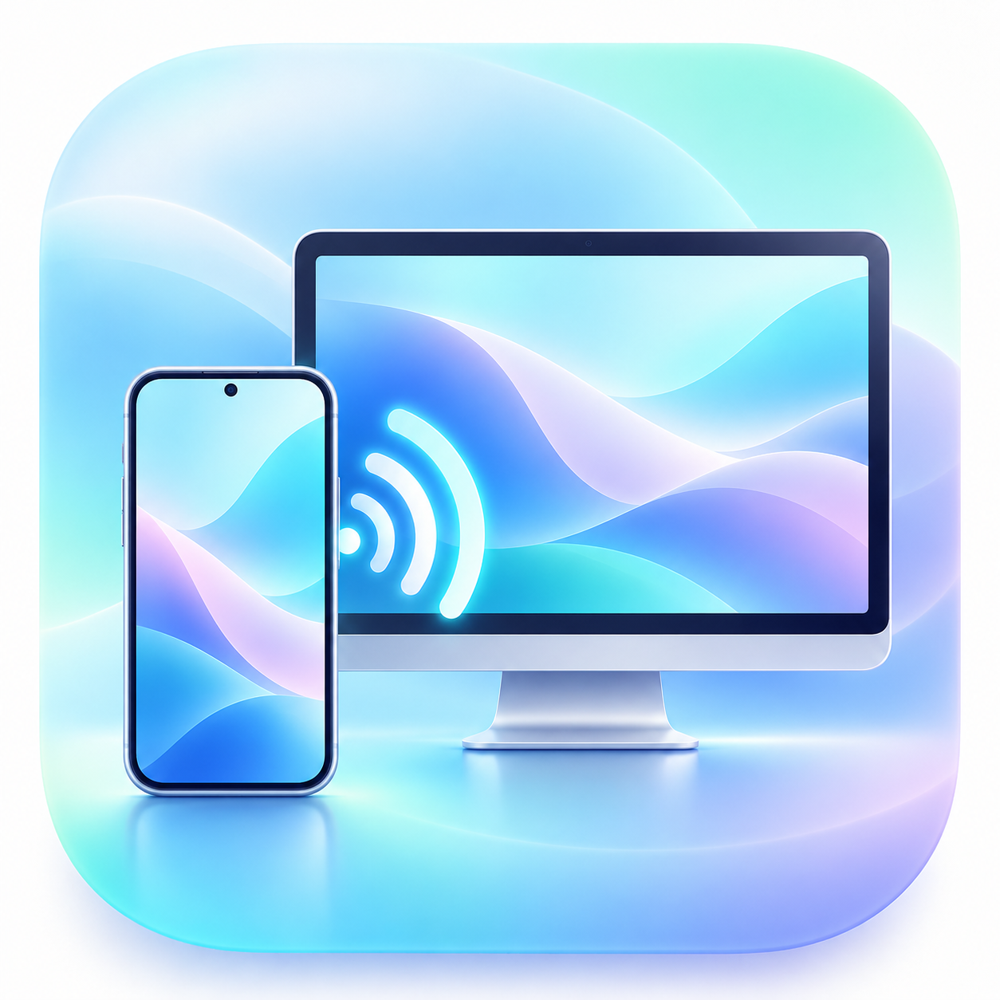

<div align="center">
  

  # Harmony Bridge

  **让鸿蒙手机出现在 Mac 上，也让操作与文件在两端流动。**

  HarmonyOS ↔ macOS · USB / Wi‑Fi · 个人测试版

  [快速开始](#-快速开始) · [功能](#-功能一览) · [已知边界](#-已知边界) · [更新记录](CHANGELOG.md) · [MIT 许可](LICENSE)
</div>

---

Harmony Bridge 由 **Mac 客户端**和**鸿蒙手机端**组成。当前版本首先面向 HUAWEI Mate 80 Pro Max（HarmonyOS 7 / API 26）与 Apple 芯片 Mac 的个人使用场景。手机桌面图标名称为 **Bridge**。

> 📱 **手机端尚未上架华为应用市场，不能从商店安装；目前必须侧载。** [下载手机 HAP](https://github.com/chinachenkeke-source/harmony-bridge/releases/download/v1.0.0/HarmonyBridge-phone-v1.0.0-debug-device-bound.hap)仅适用于其签名 Profile 中已注册的调试设备，包内含该设备的 ID。其他鸿蒙手机应使用本仓库的 `Phone/` 工程为自己的设备重新签名构建。详见[手机端安装说明](docs/PHONE_INSTALL.md)。

## ✨ 功能一览

| 功能 | 当前实现 |
| --- | --- |
| 🎬 屏幕共享 | 手机手动授权后，Mac 自动接入 H.264 画面；视频通道默认以 **60 FPS 为目标**，当前竖屏分辨率为 720 × 1552。 |
| 🖱️ 电脑操作手机 | 在投屏画面上点击、长按、拖动和滚动；提供返回、桌面、暂停与继续。 |
| 🔌 USB 连接 | 手机开启 USB 调试并授权电脑后，通过数据线连接；应用内不需要输入配对码。 |
| 📶 Wi‑Fi 连接 | 通过手机的无线调试地址连接。同一时间可保持 USB 与 Wi‑Fi 在线，并从 Mac 顶部菜单切换；手机端显示 Mac 当前选用的方式。 |
| 📁 双向文件互传 | 手机选取照片、视频或文档供 Mac 接收；Mac 可发送文件到手机，由手机端保存到文件管理。传输采用分块处理。 |
| 🔒 本地连接 | 使用已经授权的 HDC 调试通道和本机端口转发，无云端账号或自建中转服务器。 |

## 🚀 快速开始

### 准备

1. 一台可安装自开发应用的 HarmonyOS 手机；当前已在 **Mate 80 Pro Max / HarmonyOS 7** 上测试。
2. 一台 Mac，安装 **DevEco Studio / HDC**。Mac 客户端默认查找 `/Applications/DevEco-Studio.app/Contents/sdk/default/openharmony/toolchains/hdc`，也可在应用中指定 HDC 路径。
3. 在手机开发者选项中开启 USB 调试。首次连接时，在手机上允许这台电脑调试。

### 安装手机端（侧载）

手机端 **Bridge** 不是商店应用。已注册的调试设备可从 [Releases](../../releases) 下载 `HarmonyBridge-phone-v1.0.0-debug-device-bound.hap`，用 HDC 侧载；其他设备请按[手机端安装说明](docs/PHONE_INSTALL.md)，在 DevEco Studio 中打开 `Phone/` 工程，为自己的设备配置调试签名并安装。安装完成后再进行下列投屏步骤。

### 用数据线投屏

1. 从 [Releases](../../releases) 下载 `HarmonyBridge-Mac-v1.0.0.zip`，解压并打开 `HarmonyBridge.app`；或按下文从源码构建。
2. 使用 USB 数据线连接手机，解锁并允许 USB 调试。
3. 打开手机端 **Bridge**，点击“开启屏幕共享”，在系统提示中允许共享整个屏幕。
4. Mac 会自动接入画面。授权后可返回手机桌面继续使用。

### 用 Wi‑Fi 投屏

让 Mac 与手机处于同一局域网。在手机开发者选项开启**无线调试**，记下页面显示的 `IP:端口`；在 Mac 客户端右上角“更多”中选择“连接 Wi‑Fi…”，输入该地址。手机端仍需开启屏幕共享并完成系统授权。无线调试端口变化时，请输入新地址。

USB 与 Wi‑Fi 可以同时连接。Mac 顶部显示当前通道，点开可切换；手机端会同步显示 **“Mac 当前使用：USB / Wi‑Fi”**。Mac 在同一时刻只使用其中一条通道。

## 📦 文件互传

- **手机 → Mac：**在手机端选择照片、视频或文档；Mac 点击底部“文件”，在列表中接收。
- **Mac → 手机：**Mac 点击“文件”并发送，或在文件通道就绪后把文件拖入投屏区域；手机端点击“保存到文件管理”，自行选择保存位置。
- **整理共享：**手机端可移除共享副本及列表记录；此操作不会删除相册或文件管理中的原件。

文件传输依赖手机 App 运行。没有屏幕共享时，请保持手机 App 在前台；共享期间会申请后台长时任务，系统可能显示常驻通知。

## 🛠️ 从源码构建

```text
Sources/   Mac Swift / AppKit / SwiftUI / VideoToolbox 客户端
Phone/     HarmonyOS ArkTS + C++ 手机端工程
Assets/    应用图标源图与 Mac 图标
Tests/     真机连接及传输验证脚本
build.sh   Mac 构建脚本
```

在仓库根目录运行 `zsh build.sh`，需要 Apple 命令行开发工具；生成的 `HarmonyBridge.app` 位于仓库根目录。手机工程请用 **DevEco Studio** 打开 `Phone/`，安装项目依赖，配置**你自己的调试签名**，然后构建并侧载 HAP。Git 源码仓库不包含签名证书、密码或私钥。

## ⚠️ 已知边界

- 当前以这台手机的**竖屏**为主要适配目标；横屏触控坐标尚未完成验证。
- 60 FPS 是视频通道的默认目标。实际帧率和延迟受画面变化、手机发热、网络及电脑负载影响；静态画面可能不产生新帧。
- 当前**没有**系统音频转发、麦克风接管、自动剪贴板同步或文件断点续传。
- 手机系统可能遮挡受保护的画面；屏幕共享被系统结束后，需在手机端重新授权。
- 无线调试需要手机和 Mac 在同一局域网。当前版本依赖 HDC 调试授权，不面向无调试权限的普通分发安装。
- Mac 发行包采用临时本地签名，尚未公证；手机端需用自己的调试签名构建。其他机型、系统版本和长时间运行稳定性仍待验证。

## 🗓️ 版本与贡献

首个公开版本为 **1.0.0**。每次后续发布都将在 [CHANGELOG.md](CHANGELOG.md) 写明变化，并以对应版本标签和 GitHub Release 发布；流程见 [docs/RELEASING.md](docs/RELEASING.md)。欢迎通过 Issues 反馈问题，最好附上设备型号、系统版本、连接方式和复现步骤，避免公开分享调试凭据或私人文件。

项目采用 [MIT License](LICENSE)。作者：**陈可可 / Chenkeke**。
